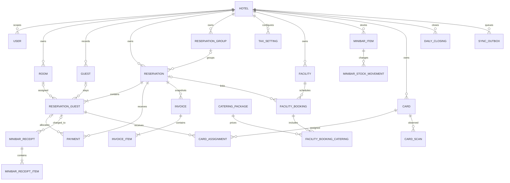
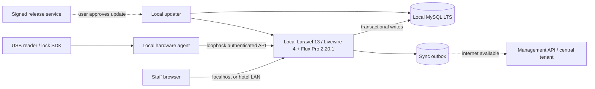

# AI Project Context — Hotel Offline PMS

Dokumen ini adalah konteks kerja untuk AI/pengembang saat merancang dan membangun ulang aplikasi. Ringkasan pengguna ada di `docs/REBUILD_PLAN.md`. Jangan menganggap fitur repo sekarang sebagai requirement final tanpa konfirmasi bisnis dan pengujian.

**Status:** Fondasi rebuild Laravel 13 dan Livewire 4 sudah ada di D:\Project\hotel_new; fitur PMS belum mulai dibangun. UI yang dipilih pemilik: Flux Pro 2.20.1; jangan gunakan Filament pada rebuild.
**Tanggal baseline versi:** 2026-10-17. Verifikasi ulang release/kompatibilitas sebelum instalasi.

## 1. Tujuan produk

Bangun Property/Hotel Management System untuk hotel kecil-menengah, berjalan penuh di server Windows milik hotel tanpa ketergantungan internet. Komputer staf mengakses server lokal melalui browser. Integrasi reader RFID dan lock harus tetap bekerja secara lokal. Ketika internet pulih, sistem dapat mengirim salinan data yang diizinkan ke pusat manajemen dan mengecek rilis aplikasi.

Prinsip utama:

1. **Local-first:** server hotel adalah sumber kebenaran transaksi harian.
2. **Offline-safe:** kegagalan internet tidak memblokir login lokal, reservasi, check-in/out, pembayaran, laporan atau pintu.
3. **Data tidak hilang karena relasi:** historical transaction immutable/voided/reversed; master dinonaktifkan; FK melindungi referential integrity.
4. **Least privilege:** layanan dan pengguna DB punya hak minimum, endpoint hardware diautentikasi, akses dibatasi ke localhost/LAN yang dibutuhkan.
5. **Update terkontrol:** paket rilis ditandatangani, backup dulu, migrasi forward-compatible, health check, baru aktif.
6. **Tanpa dependency internet runtime:** semua assets, font, scripts, dependencies, dokumentasi installer dan update fallback tersedia di paket lokal.

## 2. Aplikasi legacy yang dikaji sebagai sumber pemetaan (baseline historis)

Pada audit legacy sebelum fondasi baru, kode yang ditinjau berada di D:\Project\hotel_new, origin https://github.com/mryunkaka/hotel-bome, menggunakan Laravel 12 + Filament 4 dan constraint PHP ^8.2. Catatan pada bagian ini adalah peta alur historis, bukan deskripsi kode rebuild saat ini.

- `routes/web.php`: halaman admin, endpoint kustom, PDF dan aksi operasional; file panjang dan sebagian aturan bisnis ada di closure.
- `routes/api.php`: API RFID yang terdaftar terpisah dari web routes.
- `app/Filament/Resources`: panel CRUD/reservasi/operasi pada repo lama; hanya sumber untuk memetakan alur, tidak dipakai sebagai fondasi rebuild.
- `app/Models`: model domain dan beberapa event hook yang menyinkronkan status kamar/tenant.
- `database/migrations`: evolusi skema 2025–2026.
- `database/seeders`: data demo hotel dan akun default.
- `bridge/bridge-auto.js`: bridge Node untuk HID/serial reader dan pengiriman UID.
- `rfid/Program.cs`, `rfid/rfid.exe`, `rfid/vendor/*.dll`: program C# dan SDK vendor RFID/lock.

> **Audit route/UI hanya peta kode:** route list mencakup 88 route admin; halaman `/admin/login` memberi HTTP 200 saat dikaji. Ini tidak membuktikan semua aksi CRUD, report, atau perangkat fisik sudah berfungsi end-to-end.

## 2.1 Fondasi rebuild saat ini

Repository target: D:\Project\hotel_new; origin https://github.com/mryunkaka/hotel_bome.git. Root composer manifest menetapkan constraint PHP ^8.3, Laravel ^13.17, Livewire ^4.1, dan Flux Pro ^2.20. Lockfile lokal yang diperiksa saat penyiapan mengunci laravel/framework v13.37.0, livewire/livewire v4.4.7, dan livewire/flux-pro 2.20.1. Pastikan lockfile serta tersedianya artifact Flux pada setiap branch/clone sebelum dependency dipasang; constraint PHP bukan bukti versi PHP runtime. Fitur PMS belum diimplementasikan; route starter kit adalah fondasi, bukan acceptance PMS.

## 3. Alur operasional yang perlu dipertahankan dan diverifikasi

### 3.1 Identitas dan hotel

- Saat login, staf memilih hotel; aplikasi menaruh hotel aktif dalam session `active_hotel_id`.
- Repo punya role `super admin`, `supervisor`, `resepsionis` dan `hotel_id` pada user.
- Banyak model mencoba mengisi `hotel_id` dari session atau user ketika create/update.
- Rebuild harus memindahkan tenancy filter ke middleware/policy/query scope yang konsisten; jangan mengandalkan event model saja. Semua request baca/tulis wajib memastikan user berhak atas hotel itu. Hindari IDOR/cross-hotel data access.

### 3.2 Reservasi dan front desk

Alur konsep: cari kamar tersedia → buat reservasi/header → tambah detail tamu dan kamar → konfirmasi → check-in → catat layanan/deposit/pembayaran → cetak folio/invoice → check-out → tutup tagihan dan pulihkan status kamar → closing harian.

- `reservations` adalah header; memiliki nomor, hotel, group, pemesan, tanggal, status, tax dan audit fields.
- `reservation_guests` adalah detail per tamu/kamar; menyimpan kamar, jumlah orang, tanggal check-in/out harapan dan aktual, rate, diskon, extra bed, deposit, bill.
- `Reservation` memiliki hooks untuk nomor, tenant, tanggal detail dan status kamar; `ReservationGuest` menghitung orang/rate dan mengubah status kamar. Rebuild: letakkan perhitungan/transition eksplisit pada domain services/actions dan transaksikan dengan DB, bukan side effect tersembunyi pada model.
- Walk-in dan `bookings` masih ada sebagai domain terpisah. Pastikan apakah `bookings` fitur lama/kanal booking atau duplikasi dari `reservations` sebelum migrasi.
- Payments berhubungan dengan reservation dan optional reservation_guest. Invoice saat ini berhubungan ke bookings. Perjelas apakah invoice final harus memotret line items/rate/tax saat diterbitkan, dan tidak ikut berubah saat master pajak/harga berubah.
- Room statuses mencakup VC, VCI, VD, OCC, LS, ED, OOO, HU, RS. Definisikan state machine dan asal status; cegah status kamar bertentangan dengan occupancy aktif.

### 3.3 Operasi tambahan yang terdeteksi

- Master: hotel, user/role, room, guest, tax settings, bank.
- Front desk: room boards, reservation groups, reservations, walk-ins, guests per reservation, check-outs, deposit, payment, bill/folio, invoice.
- Keuangan: payments, daily closings, account ledgers, bank ledgers, posted/closed state.
- Fasilitas: facilities, facility bookings, catering packages, facility blocks, quick-status.
- Minibar: items, vendors, receipts/receipt items, stock movements, daily close/close items, restock.
- Kartu: cards, card assignments, validity/access data, scan endpoints.
- Output: HTML/PDF, Excel import/export, previews.

## 4. Current state: gaps, incompatibilities, and security findings

1. `CardScanController::store` validates UID and writes a log entry but does not persist to `card_scans`, resolve a card/assignment, validate an authorization window, or command a door. `latest()` returns a hard-coded null UID.
2. Bridge code sends `X-Bridge-Token`; the Laravel endpoint currently does not validate it. Existing bridge defaults contain a hard-coded development token. Treat all card endpoints as unsafe until replaced with credential validation, rate limits, replay prevention, and audit records.
3. API routes appear in `routes/api.php` and are also declared from `routes/web.php`; remove duplicate routes in rebuild. Do not disable CSRF globally; use authenticated stateless API middleware for the hardware agent.
4. Current `rfid/Program.cs` exposes a local `/scan` listener and pushes scans to Laravel. `rfid/install-rfid.ps1` uses NSSM if present; HTTP/TLS setup notes use a self-signed certificate and mutable config. Verify vendor SDK licensing, hardware compatibility, supported Windows/.NET runtime, and secure provisioning. Never assume a card UID is cryptographically secure; evaluate lock/card technology and use cryptographic cards/protocol where supported.
5. Several migrations use `CASCADE` from hotels, reservations, payments, rooms or facility records. This can erase financial/historical rows through parent deletion. Rebuild policy: no physical delete of core hotel/transaction entities; use `RESTRICT`, `SET NULL`, soft deletion, immutable snapshots and explicit reversal records. Cascade only for strictly-owned disposable child rows such as draft line items, after legal/accounting review.
6. Current migration history includes a rename of `valid_to` to `valid_until`, schema introspection, and conditional FK creation. This is evidence that upgrade paths have existing data variants. New migrations need explicit supported starting versions and tests against copied customer DBs.
7. README claims activity audit support, while `composer.json` does not include Spatie Activitylog. Define audit events and retention rather than assuming this package exists.
8. Default seeded account uses `admin@system.test` / `password`. Rebuild installer must create a unique initial administrator password and require a change; demo credentials must never ship as production credentials.
9. Data stored in `.env`, code, log output, backups, and RFID config needs tenant-boundary and secret-handling review. Avoid logging card identifiers/passwords or exposing local debug endpoints.

## 5. Recommended technology baseline

At 2026-10-17:

- Laravel **13.x**; official release 2026-03-17, PHP 8.3–8.5; bug fixes through Q3 2027, security through 2028-03-17. Select latest patched `13.x` at build time and lock composer dependencies.
- PHP **8.5.x** current stable branch (exact patch verified at packaging time); bundle compatible Windows runtime, extensions and `php.ini` rather than asking hotel staff to install PHP/Composer.
- UI: **Flux Pro 2.20.1 + Livewire 4 + Tailwind CSS 4.2+**, tanpa Filament. Pemilik memilih Flux Pro 2.20.1. Lockfile lokal yang diperiksa mematok versi itu; branch atau clone lain wajib memeriksa composer.lock dan artifact sebelum implementasi. Jangan menaikkan versi otomatis.
- Flux Pro adalah pustaka komponen berlisensi, bukan generator panel CRUD. Tim harus membangun layout, navigasi, tabel, formulir, validasi, policy, dan alur operasional sendiri. Lisensi Flux menyebut penggunaan untuk satu End Product komersial yang dapat dijual ke pengguna akhir; komponen tidak boleh didistribusikan sebagai pustaka UI tersendiri. Simpan kredensial Composer privat hanya di pipeline build, jangan di repo atau installer pelanggan. Konfirmasi entitlement lisensi saat pembelian.
- Livewire 4 mempertahankan UI tanpa reload penuh, tetapi interaksi server memerlukan request HTTP lokal dan proses render/hydration. Jangan kirim state/form besar; debounce pencarian, gunakan pagination, pecah komponen, dan hindari polling/re-render untuk semua widget. Gunakan Alpine/JavaScript lokal hanya untuk interaksi kecil yang tidak perlu menyimpan data.
- Tailwind v4 dan seluruh aset Flux/Livewire harus dibangun dan dibundel lokal. Jangan mengambil font, ikon, skrip, atau CSS dari CDN; Flux menyediakan Inter via host eksternal pada konfigurasi dokumentasi, jadi gunakan font lokal atau system font.
- Riset komunitas bersifat anekdotal dan versinya beragam: [pengalaman positif Livewire 4 + Flux (Jan 2026)](https://www.reddit.com/r/laravel/comments/1qk51s8/livewire_4_and_flux_the_best_way_to_build_web/), [laporan lambat halaman berkomponen (Jun 2025)](https://www.reddit.com/r/laravel/comments/1lg6ljv/is_flux_too_slow_or_am_i_missing_something/), [kritik Livewire soal debugging/state pada proyek kompleks (Mar 2025)](https://www.reddit.com/r/laravel/comments/1jnx27n/anyone_else_regret_using_livewire/), [kritik awal Flux tentang komponen/ketergantungan komersial (Sep 2024)](https://www.reddit.com/r/laravel/comments/1fnmtkw), dan [diskusi struktur komponen Livewire (Apr 2025)](https://www.reddit.com/r/laravel/comments/1jtvt32). Kesimpulannya bukan bahwa Flux pasti cepat atau lambat: laporan positif ada, tetapi kinerja dan kemudahan maintain bergantung versi, ukuran state, pola komponen, query, dan pengalaman tim; sebagian kritik menyangkut versi yang lebih lama dari target. Jangan jadikan komentar sebagai benchmark. Ukur layar front desk, kalender ketersediaan, folio, dan laporan dengan data realistis; bandingkan durasi XHR, query, payload, dan render.
- MySQL **9.7 LTS** as current stable LTS line at this baseline. Use the latest security patch of that LTS line and verify the Windows binary/extension compatibility in the release build. MySQL LTS is appropriate for predictable customer installs; do not choose Innovation track for hotel production.
- FrankenPHP Windows binary + WinSW as a candidate single web/PHP Windows service. Prototype on target Windows versions before final choice; confirm every required PHP extension (PDO MySQL, GD/Imagick, intl, zip, fileinfo, mbstring, openssl) and library (PDF/Excel/Image) works. It does not replace MySQL.
- MySQL runs as a separate Windows service; app binds DB to loopback and uses a dedicated non-root app account.
- RFID service stays separate if vendor DLL/device requires it; prefer C#/.NET over shipping a generic Node runtime when the SDK already requires native Windows DLLs. Package reader SDK only under vendor redistribution terms.
- Vite/Node build happens only in development/release CI. Ship compiled assets. Customers do not need Node/npm/Git/Composer.
- Do not include `Reverb`, Redis, queue brokers, search services or Docker unless verified features require them. Offline one-server mode should start with Laravel database queue/cache/session or simple sync outbox. Use database queue only for work that is genuinely deferred; keep short front-desk actions synchronous.
- Avoid treating cache clearing as a routine repair. Pin the release lockfile and build caches only during release. Monitor storage/log/temp-export size; retain and prune logs/exports on schedule, and test a low-disk notification/recovery path.
- Define an explicit migration ledger/release compatibility range and preflight: database backup is readable, disk space is sufficient, current schema is supported, services are stopped or in maintenance mode, and the migration plan is additive. MySQL schema DDL may not roll back as one transaction, so each migration must be small, restart-aware, and recoverable; never solve a failed upgrade by repeatedly rerunning arbitrary SQL or dropping tables.

Official references:

- Laravel release policy: https://laravel.com/framework/docs/releases
- Laravel production deployment: https://laravel.com/framework/docs/deployment
- Flux installation: https://fluxui.dev/docs/installation
- Flux Pro 2.20.1 tag/release history: https://github.com/livewire/flux/releases
- Flux license terms: https://fluxui.dev/terms
- Livewire 4 hydration and installation: https://livewire.laravel.com/docs/4.x/hydration and https://livewire.laravel.com/docs/4.x/installation
- PHP supported versions: https://www.php.net/supported-versions.php
- MySQL LTS policy: https://dev.mysql.com/doc/refman/9.7/en/mysql-releases.html
- FrankenPHP on Windows/services: https://frankenphp.dev/docs/production/
- FrankenPHP embedded app binaries: https://frankenphp.dev/docs/embed/

## 6. Conceptual ERD

This is a target starting model, not an exact diagram of every existing column. `hotel_id` partitions operational rows. Historical parent relations should generally be retained.

Add these target entities when the corresponding module is built: `RATE_PLAN`, `RATE_RULE`, `ROOM_TYPE`, `ROOM_BLOCK`, `RESERVATION_SOURCE`, `FOLIO`, `FOLIO_POSTING`, `CHARGE_ROUTING`, `CASHIER_SHIFT`, `BUSINESS_DAY`, `NIGHT_AUDIT`, `COMPANY_ACCOUNT`, `TRAVEL_AGENT`, `HOUSEKEEPING_TASK`, `MAINTENANCE_ASSET`, `WORK_ORDER`, `INVENTORY_LOCATION`, `STOCK_MOVEMENT`, `PURCHASE_ORDER`, `GOODS_RECEIPT`, `FACILITY_EVENT`, `POS_ORDER`, `LOYALTY_LEDGER`, `AR/AP`, `JOURNAL_ENTRY`, `BUDGET`, and `FIXED_ASSET`. Treat this as a domain inventory, not a command to create hundreds of tables before workflows are known. Prefer ledger/event rows for amounts, inventory, loyalty, and access history; store current status as a projection where it improves screens.

Recommended shared entities: `audit_events`, `sync_outbox`, `sync_receipts`/cursor, `client_devices`, `update_installations`, and immutable snapshots for posted invoices/financial operations. Add explicit `hotel_id` composite constraints/index strategy where needed; IDs alone must not authorize access to another hotel.

## 7. Target architecture and data flows

### Local runtime

- One hotel server owns app + local MySQL. Staff machines are clients, not separate database servers.
- With all networking disconnected, use the server's `localhost` browser. Other staff computers require the hotel's LAN; local-first does not mean a second computer can connect without a network. WAN loss must not affect operations.
- If single-computer, bind web app to `127.0.0.1` only. If multi-computer, allow only an explicit hotel LAN subnet and block public/WAN access. MySQL stays bound to loopback; clients never connect directly to DB.
- FrankenPHP + WinSW may combine HTTP server and PHP runtime into one Windows service. MySQL is separate. A device agent is a third service only when hardware requires it. A single signed installer installs/configures these runtimes; hotel staff should not install developer tools.
- Deploy web root as Laravel `public/`; `.env`, vendor internals, backups, logs and database files must never be web-accessible. Use service identity with write access only to `storage`, `bootstrap/cache`, backup targets and required hardware devices.
- Use local static assets and no analytics or external fonts/CDN. The login, dashboard, reports and local APIs must work with DNS and WAN disconnected.

### Cloud sync

- A domain transaction and outbox event commit in one local DB transaction.
- Event has globally unique `event_id`, tenant/device IDs, entity key, schema version, timestamp, actor, payload version, and privacy classification.
- Sync worker sends events with TLS, client credential/certificate, idempotency key, bounded batches, retry/backoff and explicit server acknowledgment. Store sync cursor and retry/error state locally.
- Server deduplicates event IDs. Define conflict rules by domain: local property owns room inventory, reservations, check-in/out, payments and lock events; central owns customer/license registry and release catalog. Central changes to hotel configuration require explicit versioning and conflict review.
- Sync deletion as tombstone/disable events, never as a remote physical delete. Data scope, retention, consent, encryption-at-rest, and customer contract must be defined before syncing guest PII.
- If no internet for days/weeks, outbox grows safely, app remains operational, and staff can export an encrypted support/sync bundle without exposing secrets.

### Release/update flow

1. Developer pushes source to private Git hosting. CI builds reproducibly, runs static analysis/tests, packages locked dependencies and compiled assets, generates SBOM, computes checksums, and signs release metadata/artifact.
2. Release contains app build, runtime version, required migration range, minimum updater, checksum/signature, notes, and rollback/backup instructions. Customer never receives Git credentials or a live source checkout.
3. Local app checks a small signed manifest when online and displays version/notes. No automatic install without a customer admin action unless separately agreed.
4. Updater downloads package to a staging folder, verifies signature before extraction, checks disk/database/version, closes worker/maintenance gate, backs up database and writable files, installs version into a new release directory, then runs only forward-safe `artisan migrate --force`.
5. Health check (`/up` plus DB, writable storage, schema version and a local functional smoke check). Switch active release only on success; otherwise restore previous code and report restore-required if schema changed.
6. Database rollback is not a generic safety strategy. Favor forward-only additive migrations and restore-from-backup for a failed breaking migration. Offer offline USB/import package path signed the same way.

## 8. Schema and deletion rules

- Every business entity belongs to a hotel; tenant scoping is enforced at authorization, queries, exports, jobs, reports and API layer.
- No delete cascade from hotel/reservation/guest/room to posted money, invoices, cards, audit or sync records.
- FK behavior: `RESTRICT` for business history; `SET NULL` for optional actor/master references where the history remains readable; limited cascade for unposted child rows explicitly owned by a draft parent.
- Use soft-delete/active flags for hotels, users, rooms, guests, rate plans, tax settings, facilities, items and cards. Re-activation preserves history and IDs.
- Posted money, closing, invoice snapshot, card issuance/revocation and lock access events are append-only. Correct with reversal/adjustment records and reason/actor/time.
- Use UUID/ULID or generated event IDs for cross-site synchronization. Keep local numeric PKs if useful; do not assume the same integer IDs exist centrally.
- Use `DECIMAL` for amounts, explicit currency, timezone strategy (store UTC; display property timezone), unique numbers by hotel/period, checks/indexes for all common reports.
- Migration process: add nullable/new column/table → backfill in batches → deploy compatible reader/writer → verify counts/invariants → stop writing old field → remove old field in later release only after backup and minimum-version policy. Every down path must be reviewed; production updater must never call `migrate:fresh`.

## 9. Security and intellectual-property boundaries

- Offline mode means local network/server access still exists; protect Windows host, admin accounts, backups and ports. Encrypt disks/backups, use unique installer secrets/passwords, restrict local firewall and audit admin actions.
- Use per-customer license identity and signed entitlement, stored with an offline grace policy. Never place a vendor master key or GitHub PAT in customer files.
- Signed releases establish integrity and publisher identity; they do not make local PHP unreadable. Bundling to EXE is convenience and modest tamper resistance, not a guarantee of source confidentiality.
- If source confidentiality is a requirement, keep truly proprietary algorithms/services on a vendor-managed endpoint (but then feature is not fully offline), or evaluate a native/encoded component plus legal/license controls. Decide explicit trade-off before architecture is finalized.
- Use least-privilege DB account; password hash via Laravel; MFA for support/admin where practical; rate limits/lockouts; session rotation; CSRF for browser flows; policy checks and tenant-safe file storage; never expose debug/diagnostic endpoints on LAN.
- RFID: authenticate agent with a per-install secret/certificate, rotate/revoke it, timestamp + nonce/replay protection, request signature, strict local bind, allowlisted operations, idempotent scan IDs, per-door permissions, access schedule and audit. Do not accept reader-supplied `hotel_id` or user identity as authoritative.
- Verify vendor DLL/SDK redistribution license and security/update policy before bundling `rfid/vendor` binaries.

## 10. Functional scope and build sequence

Target scope must include all functions below in the product architecture, then release them in usable slices. “Masuk cakupan” does not mean all must be delivered in the first release; the owner can prioritize after operational discovery.

### 10.1 PMS operational core

- Property/hotel setup, outlets, room types, rooms, amenities, room status board, out-of-order/out-of-service and room feature/accessibility notes.
- Rates, seasonal/date-based rules, packages, taxes/fees, discounts, occupancy/extra-bed rules, availability and forecast. Keep historical booked rate/tax snapshots.
- Guest profiles, contact and identity documents with restricted access, preferences, stay history, consent/retention, duplicate matching, company/travel-agent profiles and negotiated rates.
- Individual/group reservations, room blocks, rooming list, multi-room booking, source/channel, deposit, change history, confirmation, cancellation/no-show rules, walk-in, waitlist and overbooking policy if approved.
- Front desk: arrivals/departures/in-house lists, pre-registration, check-in/out, room move/share, key/card issue and revocation, guest notes, folio transfer/charge routing, multiple folios, invoice/receipt, tax invoice fields, payment/refund and cash/shift close.
- Night audit/business date: ensure pending charges/postings, close business day, reconcile cashier totals, produce reports and preserve reopening/audit controls. Do not equate midnight with a closed hotel business date.
- Folio and finance events: room/ancillary charges, deposits, payments, refunds, adjustments, void/reversal reasons, split tender, receivables/company billing, aging and export. Posted items immutable; each correction leaves an audit trail.

### 10.2 Operasi dan pendapatan tambahan

- Housekeeping: clean/dirty/inspected/occupied status, room assignment by attendant, task/checklist, priority/rush room, discrepancy, lost & found, linen/amenity tracking where requested, productivity report.
- Engineering: equipment/assets, preventive maintenance schedule, work orders, priority, parts/labor, room unavailable blocks and completion history.
- Inventory/procurement: item/unit/location/warehouse, supplier, purchase request/order, receiving, invoice/payment, transfer, issue/use, return, stocktake, movement ledger, reorder and minibar consumption/posting. No silent stock overwrite.
- Facilities/meetings/events: facility resource/availability/block, event booking, packages, catering/BEO, quotation, deposits, charges, room setup, event schedule and post-event billing.
- POS and room service: outlet/menu/items, order/room charge, kitchen/service status, cashier reconciliation and integration contract. A local POS can work offline; payment acquirer settlement may wait for connection.
- Sales/marketing: company/agent production, sales activities, quotations, account history, negotiated contracts, commissions and campaigns. Campaign delivery/online ads are network-dependent.
- Loyalty/membership: enrollment, earn/burn ledger, expiry, manual adjustment approvals and booking linkage. Guest mobile portal is optional and network-dependent.

### 10.3 Keuangan, laporan, dan administrasi

- Cash/bank, AR/AP, manual and automatic journal, general ledger/subledger, account mapping, fixed assets/depreciation, budget, cash clearance and period close where required by the customer's accounting workflow.
- Reports for occupancy, arrivals/departures, room revenue/ADR/RevPAR, forecast, reservations/source, cashier/payments/refunds, outstanding balances/aging, night audit, housekeeping, maintenance, inventory movements/valuation, minibar, facility/event revenue, sales, taxes and accounting trial balance/P&L/balance sheet.
- Report filters/date/business date/outlet, export/print, role-based access and reproducible snapshots. Confirm local tax/accounting rules with the hotel accountant before implementation; do not assume one chart of accounts or statutory tax schema fits all properties.
- Users/roles/departments/outlets, approval limits, audit events, backup/restore, import/export validation, health page, operational configuration, retention and data subject workflows.

### 10.4 Integrasi pada PDF proposal dan kompatibilitas offline

Proposal yang diberikan mencantumkan PMS (front office, cashier, engineering, housekeeping, sales & marketing, budgeting, room forecast, reports, inventory, accounting, POS interface), direct booking/website dan booking engine, OTA/channel manager, gateway pembayaran, membership/loyalty, QR room service, self check-in/digital key, serta integrasi doorlock.

| Fitur proposal | Rencana dukungan |
|---|---|
| PMS, cashier, laporan, budgeting/accounting, inventory, fasilitas/catering, minibar | Modul lokal inti; tetap bekerja tanpa WAN |
| RFID/kartu dan doorlock | Integrasi lokal, tergantung model lock/SDK; uji dan otorisasi aman sebelum produksi |
| POS/room service QR | POS lokal dapat berjalan; QR mobile harus mengakses server LAN dan memakai autentikasi/sesi aman |
| Website/booking engine, OTA/channel manager | Konektor opsional; perlu internet dan aturan rekonsiliasi ketersediaan/pemesanan |
| Gateway/VA/kartu/QRIS | Online dan bergantung provider; saat offline tandai belum terbayar, jangan berpura-pura sukses |
| Self check-in/mobile guest/digital key | Opsional; perlu LAN/perangkat yang kompatibel. Payment/identity checks tertentu perlu layanan online |
| Sync pusat dan notifikasi update | Tambahan saat WAN pulih; operasi lokal tidak menunggu sync |

Matriks ini mencakup isi PDF sebagai target discovery. Detail pajak, gateway Indonesia, kanal OTA, vendor lock, format invoice, serta aturan akuntansi masih perlu dikonfirmasi dengan pihak hotel dan vendor. Fitur eksternal harus mempunyai status queued/failed/reconciled yang jelas dan mencegah duplikasi.

### 10.5 Urutan rilis yang disarankan

1. **Fondasi dan front desk:** installer offline, first-admin wizard, role/policy, hotel/kamar/tamu/rate, availability, reservasi/grup/walk-in, check-in/out, folio multi-tagihan, deposit/pembayaran, invoice, cashier, business date/night audit, laporan dasar, audit, backup/restore.
2. **Operasi hotel:** housekeeping, maintenance, minibar/inventory/purchasing, facilities/events/catering, POS/room service, sales accounts, laporan operasional.
3. **Akuntansi lanjutan dan perangkat:** AR/AP/GL/budget/fixed assets sesuai keputusan akuntan; doorlock/RFID setelah protokol vendor dan perangkat uji disahkan.
4. **Konektivitas opsional:** booking engine/OTA/payment gateways/guest portal; outbox sync pusat, license service, signed update catalog dan updater. Semua konektor gagal dengan aman saat offline.

Prioritaskan alur pegawai dan penutupan shift. Tidak ada operasi kritis yang bergantung pada cloud sync, layanan notifikasi, atau akses internet.

## 11. Acceptance checklist for later implementation

- Clean Windows installation works without internet from a pre-downloaded installer; no Node, npm, Composer, Git or manual config needed.
- Reboot automatically starts services, app opens locally, health check explains a failed service without exposing secrets.
- Browser login works with seeded/created property and role; user cannot view or change another hotel's data by URL manipulation, export, relation selector or background job.
- Full reservation → check-in → charge/deposit/payment → invoice/folio → check-out → daily close flow survives restart and audit review.
- Attempted deletion of posted financial data fails safely; master disable preserves old reports; schema updates retain data across at least two prior supported versions.
- Backup restore tested on a second machine; backup is encrypted and includes DB, uploads, license/identity recovery method and exact software version.
- WAN disconnected before login and during writes: all core flows continue. WAN restored: sync retries without duplicates; conflict queue is visible.
- Update package fails signature/checksum test; updater refuses it. Valid update backs up, applies additive migration, health-checks and reports result. Interrupted update can recover.
- RFID: valid card works offline; expired/revoked/wrong-property card is denied; duplicate/replay event is idempotent; unplugged reader and unavailable cloud do not hang front desk; every grant/deny has a local audit record.
- LAN exposure scan verifies MySQL and service diagnostics are not reachable to guest/WAN networks.

## 12. Discovery questions to settle before code

1. One property per customer install, or several hotels managed by the same local installation?
2. One server and multiple LAN workstations, or strictly one standalone computer?
3. Which lock manufacturer/model/card family and SDK redistribution rights? Does app write cards, merely enroll UID, or both?
4. Which exact report formats, tax/accounting rules, currencies, day-close rules and payment methods must ship in Release 1?
5. Which guest/customer data is permitted to leave hotel premises, and is sync one-way or do central users edit operational data?
6. What customer license/offline validity/renewal policy and support/update terms are desired?
7. Which of the proposal functions (OTA, payment provider, QR ordering, self check-in, POS, accounting) are required in the first sale, and which are later optional connectors?
8. Does Flux Pro entitlement cover the same commercial product installed for multiple hotel customers? Record the purchased plan and redistribution terms before bundling.
9. Which workflows require cashier approval, dual control, tax invoice numbering, business-date reopening, room moves, split folios and company billing?

## 13. Current files inspected

- `composer.json`, `README.md`
- `routes/web.php`, `routes/api.php`, `bootstrap/app.php`
- `app/Filament/Resources`, `app/Filament/Pages`
- `app/Models` (not every hook or relation exhaustively audited)
- `database/migrations`, `database/seeders/InitialSetupSeeder.php`
- `app/Http/Controllers/Api/CardScanController.php`
- `bridge/bridge-auto.js`, `rfid/Program.cs`, `rfid/install-rfid.ps1`, `rfid/HTTPS-SETUP.txt`

This is not a formal security audit, complete ERD reverse-engineering, hardware certification, accounting sign-off, or proof that all UI flows work. Continue discovery from real screens and staff procedures before final schema/API contracts.
