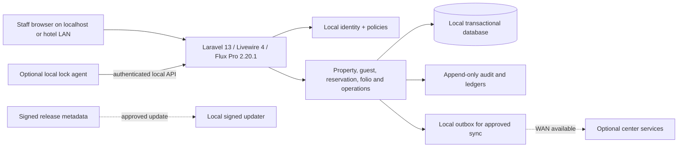

# Arsitektur Sasaran

**Status:** Logical architecture baseline. Tenant topology and LAN access are owner-confirmed; runtime, reporting rules, vendors, and delivery mechanics have open decisions.

## Teknologi terpilih dan bukti repository

- PHP constraint `^8.4.1`, Laravel `^13.17`, Livewire `^4.1`, Flux Pro `^2.20` pada root `composer.json`; locked Symfony 8.1 packages require PHP `>=8.4.1`.
- `docs/AI_PROJECT_CONTEXT.md` dan constitution menyebut local Flux lock 2.20.1. File lock/archive 2.20.1 adalah perubahan lokal pengguna; belum disertakan ke remote workflow branch.
- Tailwind CSS v4 / Vite in `package.json` and `resources/css/app.css` should be checked for exact locked version before build.
- Testing: PHPUnit configuration uses SQLite `:memory:`; package script `composer test` includes Pint, PHPStan and Artisan tests. No test run is claimed in this planning pass.
- No PMS domain models/tables/routes exist in inspected app inventory; only starter User, auth/settings/dashboard, and starter migrations are present.

## Logical components

## Boundaries

1. Browser actions use application authorization; IDs and property identifiers from clients are untrusted.
2. Business writes, audit event and sync-outbox event (when applicable) commit atomically.
3. Local database owns daily hotel transactions. Cloud owns only explicitly assigned central registry/license/release data; sync conflict rules are domain specific.
4. Hardware adapter has per-install identity, replay protection, strict local binding, allow-listed actions and auditable decisions.
5. Release packaging is separate from runtime data; Git is for source, not customer credentials/data or commercial package archives.

## Data isolation and history

One installation manages several hotels (owner-confirmed D-001); user access is assigned per hotel/property. Self-registration creates a pending account which cannot log in before admin approval; the first admin is created via a one-time local wizard which then locks (owner-confirmed D-003). Enforce hotel/property ownership in query scopes, policies, actions, exports, jobs and API—not only UI filtering. Staff access from multiple workstations over hotel LAN is owner-confirmed (D-002); subnet/firewall and supported topology require site configuration and pilot. Use FK constraints and explicit restrictive behavior for history. Posted finance, invoices, closures, card assignments, audit and sync receipts are append-only; correct with compensating records. Store money as DECIMAL with currency; persist booked rate/tax and issued-document snapshots. UUID/ULID identifiers may support cross-site events, while local numeric keys may remain internal.

## Local runtime

Intended target is a Windows hotel server, local database, browser access, static local assets and no WAN dependency for core flows. MySQL stays loopback-only and clients do not connect to it. FrankenPHP + WinSW are candidates, not selected/validated production components. Do not add Redis, Reverb, broker or external service without an approved need and measured reason.

## Security and observability

Least-privilege service/DB accounts, CSRF/session controls, rate limits, safe error pages, role/property checks, secret-free logs, encrypted backups, local audit trail, disk/service health checks and LAN firewall boundaries. Test denial and offline behavior; do not expose debug endpoints or secrets to LAN.

## Open architecture decisions

See `OPEN_DECISIONS.md` IDs D-004 through D-010. D-001 and D-002 are owner-confirmed; D-003 sets self-registration with admin approval before login. Finance and hardware decisions block only their own slices. Avoid final schema/API commitments until remaining decisions are resolved.
