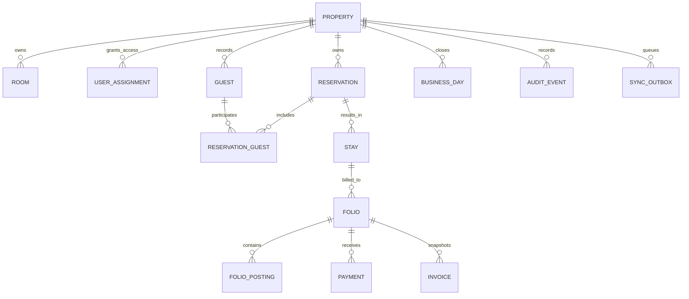

# Domain Model Inventory

This is an initial domain map derived from the discovery context. It is not a finalized ERD or an instruction to generate all tables in advance. Each feature must refine its entities, invariants, references, and lifecycle in its own `data-model.md` before implementation.

## Core aggregates

| Area | Candidate aggregates / records | Invariants to preserve |
|---|---|---|
| Identity & tenancy | User, Role/Permission, Property/Hotel, Outlet, Membership/Assignment | Every read/action scoped by authorized property; tenant cardinality pending D-001 |
| Property inventory | RoomType, Room, Amenity, RoomBlock, RoomStatusHistory | Room status history/audit retained; out-of-order blocks affect availability |
| Guest & commercial | Guest, GuestIdentityDocument, Consent, CompanyAccount, TravelAgent | PII restricted, retention/consent documented, duplicate matching non-destructive |
| Pricing | RatePlan, RateRule, Package, Tax/Fee, Discount, RateSnapshot | Reservation/folio retains booked price/tax basis; tax rules pending D-004 |
| Reservation | Reservation, ReservationGroup, ReservationGuest, RoomAssignment, ReservationSource, ChangeEvent | Availability conflict controlled; cancellation/no-show policy pending D-005 |
| Stay & folio | Stay, Folio, FolioPosting, Deposit, Payment, Refund, Invoice, InvoiceLineSnapshot | Posted rows immutable; adjustments/reversals reference originals |
| Cash & date | CashierShift, Tender, Reconciliation, BusinessDay, NightAudit, ClosingSnapshot | Close is explicit business date, never inferred solely from midnight |
| Operations | HousekeepingTask, Asset, WorkOrder, InventoryItem, StockMovement, PurchaseOrder, GoodsReceipt | Movement ledger, no silent quantity overwrite; status changes auditable |
| Events & outlets | Facility, FacilityEvent, Catering/BEO, POSOrder, POSLine, KitchenStatus | Capacity/availability and posted charges link to authorized records |
| Finance | AR/AP, JournalEntry/Line, Account, Budget, FixedAsset | Accountant and statutory rules required before final posting design |
| Cross-cutting | AuditEvent, Attachment, Device, Card, CardAssignment, CardScan, SyncOutbox, SyncReceipt, ReleaseInstallation | Secrets/PII minimized; IDs are not authorization; idempotency and retention explicit |

## Relationship sketch

## Retention and deletion

Use RESTRICT for posted financial/history parent references and SET NULL only for optional actor/master links whose audit context survives. Limited cascade may apply only to draft-only owned children after explicit lifecycle rules. Prefer disable/archive for business masters. Each migration is additive and restart-aware; no production `migrate:fresh`.
